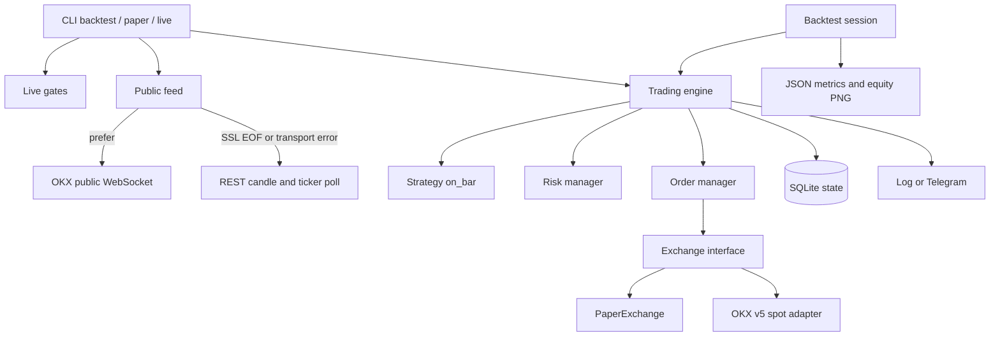

# OKX spot trading engine

Spot-only research and execution engine for OKX v5. It paper-trades by default.
No strategy in this repository has been shown to be profitable. Backtests are
not a forecast and are not a reason to trade live.

The included Donchian breakout is a **placeholder** pending a researched
specification. Earlier reversal research failed. Live trading stays off until
you pass every safety gate on purpose.

## Safety model

* Default command path is paper. `mode: live` in YAML does nothing by itself.
* `okxspot live` requires **both** `--enable-live` and
  `OKX_LIVE_CONFIRM=I_ACCEPT_LIVE_TRADING_LOSS_RISK`.
* Live startup loads `GET /api/v5/account/config` and **refuses** a key whose
  `perm` includes `withdraw`. Missing or empty permissions fail closed. The
  key must include `trade`.
* Live startup refuses to run when `allocated_capital` is missing, not
  positive, or greater than `max_allocated_capital`.
* Sizing never uses total account equity (`totalEq`).

```
sizing equity = min(allocated_capital + bot realized PnL, available USDT)
```

`available USDT` is OKX `availBal` for the quote currency. It is only a
ceiling so the bot cannot spend cash it does not have. Extra funds in a
shared account are ignored. Run this in a **dedicated OKX sub-account**
funded with the allocated amount and a trade-only API key.

* Fixed fractional risk is capped at 0.5% to 1% of that sizing equity.
* Stops are sized from ATR distance, then rounded down to the instrument
  lot size. Orders below the minimum size or minimum notional are skipped.
* Caps: max concurrent positions, max gross exposure, per-coin notional.
* A daily loss limit blocks new entries. It does not flatten.
* A max-drawdown kill-switch flattens open spot positions and halts. The halt
  is stored in SQLite and survives a restart.
* A losing close starts a cooldown of N bars.
* Client order ids are deterministic. Restarts reconcile with the exchange
  instead of sending the same intent twice.
* Spot only (`tdMode=cash`). Swap and futures symbols are rejected.
* Tests set `OKXSPOT_DISABLE_NETWORK=1`. A real OKX client without a mock
  transport cannot place orders in that mode.

API keys are read from the environment only. See `.env.example`. Do not put
secrets in YAML, and do not commit `.env`.

## Architecture



Public market data prefers the OKX websocket. Some networks fail that socket
with an SSL EOF (`EOF occurred in violation of protocol`). The feed treats
SSL EOF, connection reset, and timeouts as a hard fallback: it logs the
failure and polls REST `/api/v5/market/candles` and ticker data for the rest
of the process. It does not keep retrying a broken socket.

Backtests are event-driven. A signal on a closed bar fills at the next bar's
open, with configurable fees and slippage. The default backtest fee is
**2× the taker fee**. Reports include an in-sample / out-of-sample time split
and walk-forward windows. Parameters are **not** optimized on the in-sample
window. The report is a holdout view, not proof of an edge.

## Layout

```
config/default.yaml          # allocated capital, risk, fees; no secrets
src/okxspot/config.py        # pydantic settings
src/okxspot/safety.py        # live gates and key loading
src/okxspot/exchange/        # interface, OKX REST/WS, paper simulator
src/okxspot/marketdata.py    # websocket with REST fallback
src/okxspot/strategy/        # on_bar plug-in; Donchian placeholder
src/okxspot/risk/            # sizing equity, rounding, kill-switch
src/okxspot/orders/          # idempotent ids, reconciliation
src/okxspot/engine.py        # bar loop
src/okxspot/backtest/        # downloader, metrics, PNG report
src/okxspot/cli.py           # backtest | paper | live
tests/                       # pytest
```

## Run paper mode

Requires Python 3.11+.

```bash
python3.11 -m venv .venv
source .venv/bin/activate
pip install -e ".[dev]"

# Offline paper replay. No API key. No network.
python -m okxspot paper --config config/default.yaml --demo --once

# Offline backtest, JSON + equity curve PNG.
python -m okxspot backtest --config config/default.yaml --demo --output artifacts/demo
```

Historical OKX candles (public REST, cached under `data/cache`):

```bash
python -m okxspot backtest --config config/default.yaml \
  --start 2024-01-01 --end 2024-06-01 --output artifacts/history
```

Paper against the public feed (websocket, then REST if the socket fails):

```bash
python -m okxspot paper --config config/default.yaml --once
```

## Live mode

Do this only in a dedicated sub-account, with a key that cannot withdraw,
and only after you accept that this placeholder strategy is not validated.

```bash
export OKX_API_KEY=...
export OKX_API_SECRET=...
export OKX_API_PASSPHRASE=...
export OKX_LIVE_CONFIRM=I_ACCEPT_LIVE_TRADING_LOSS_RISK
python -m okxspot live --config config/default.yaml --enable-live --once
```

Set `allocated_capital` to the USDT you intend this bot to use, and
`max_allocated_capital` to the hard ceiling. If you omit the cap or set it
above the max, live mode exits before it talks to the private trade API.

Optional Telegram alerts: set `telegram.enabled: true` and provide
`TELEGRAM_BOT_TOKEN` and `TELEGRAM_CHAT_ID`. If they are missing, alerts stay
in the JSON log.

## Tests

```bash
ruff check src tests
mypy
pytest
```

The tests never call the real OKX trade API. They do not contain keys.
Nothing here is a promise of profit.


## Live readiness extras (paper / demo only)

See the repository root README, `docs/live_readiness/`, and:

* `okxspot kill` / `okxspot rearm` — file kill switch, manual re-arm only
* `okxspot demo-dry-run` — exits cleanly when no demo key is present
* `okxspot supervise` / `scripts/supervise-paper.sh` — watchdog (never pid 129703)
* Config flags: `live_enabled` (default false), `require_dedicated_subaccount`, `require_ip_restriction`
* Demo header: `x-simulated-trading: 1` when `OkxClient(simulated=True)`
